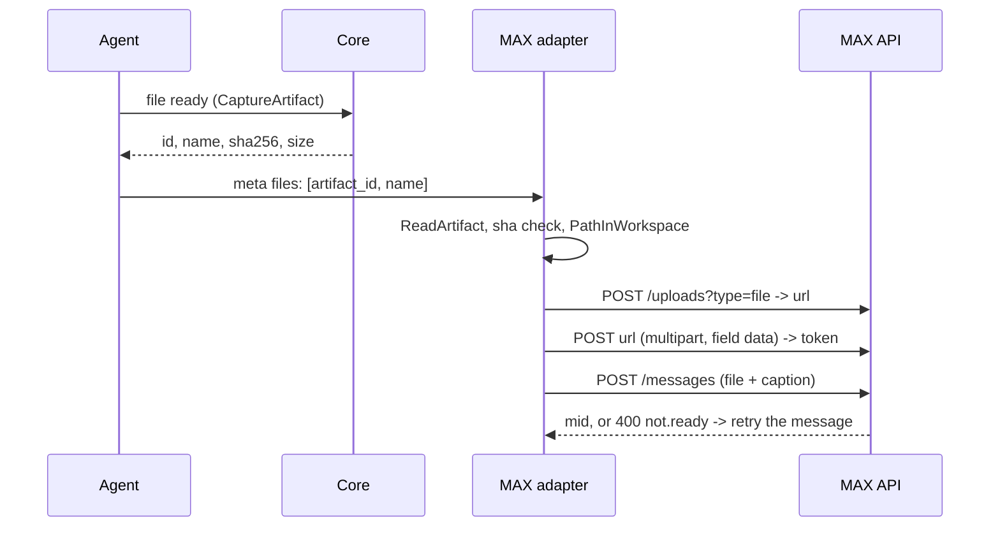

# Plan: documents in the MAX gateway

*Written 19.10.2026 in the operations session, from a live experiment rather than from the
reference alone. Extended and approved in the Max-Gate session on 19.10.2026 — decisions D1–D8
are settled, not proposals. Nothing here is implemented yet.*

**Status: approved by the operator 19.10.2026.** The code may start, beginning with the live probe
on Go.

## Goal

Teach the gateway to send **files** into a MAX chat — PDF, DOCX, XLSX, CSV, TXT, ZIP, MD — as a
`file` attachment with a caption, the way it already sends text, images and keyboards. A turn that
produces a report, an invoice or an export should be able to hand it to the chat.

**Out of scope:** documents coming *from* the user (incoming files are a separate phase), several
files in one message, and resumable upload.

## What was measured (live, 19.10)

A real PDF (`Счет№00000001.pdf`, 33 068 bytes, PDF 1.4, one page) sent to a live MAX chat:

```
POST /uploads?type=file                 -> 200, answer carries "url" only, no token
POST <that url>  multipart, field data  -> 200, and the answer carries "token"
POST /messages?chat_id=…&disable_link_preview=true
    {"text": "…", "attachments": [{"type": "file", "payload": {"token": "…"}}]}
                                        -> 200, message carries attachment type "file"
```

The delivered message came back as `mid.<message id>` with
`attachments: ['file']`. A Cyrillic filename survived the upload intact.

**Two traps, both hit on the live API:**

1. **TLS is two different trust anchors.** `platform-api2.max.ru` is signed by the Mincifry root;
   the host that receives the bytes is signed by an ordinary public CA. A context built as
   `create_default_context(cafile=<mincifry>)` trusts *only* that file and the upload dies with
   `CERTIFICATE_VERIFY_FAILED`. The fix is a system context **plus** the Mincifry root loaded into
   it. Our `withRootCA` (`bot.go:264`) augments the system pool rather than replacing it, and
   `UploadImage` posts through `c.http` — the shape is already right, but a test must cover it.
2. **`attachment.not.ready`.** The first `POST /messages` answered `400` with that code; the retry
   three seconds later answered `200`.

**Not verified, and therefore not to be assumed:** the Go client path (the experiment was Python);
whether MAX accepts several files in one message; how a long filename is rendered; whether
`.docx`/`.xlsx`/`.zip` are accepted; behaviour at hundreds of megabytes.

## Platform facts

| What | Value | Source |
|---|---|---|
| `file` size | up to **4 GB** | `api/uploads.md:27`, `api/attachment-types.md:17` |
| Accepted formats | "common formats (for example TXT, DOC and others)" — **no list, no enum**; `filename` and `size` are free fields | `api/uploads.md:26`, `schema.yaml:2502-2520`, upload page 19.10 |
| Message text | **`maxLength: 4000`** | `schema.yaml:2193`, `:2228`; filed in `api/new-message-body.md` |
| `image` | 50 MB **or** 7680×7680 px (both) | `api/attachment-types.md:14` |
| `video` / `audio` | 250 MB / 256 MB or 60 min | `api/attachment-types.md:15-16` |
| Rate | 30 rps, at most 2 messages per second per chat | `api/updates.md:66`, `api/sending-messages.md:55` |
| Upload shapes | **multipart** (whole file, no resume) or **resumable** (`Content-Type` not `multipart/form-data`, chunked, resumable) | `POST /uploads` page, 19.10 |
| Upload address | **one file per address**; another file needs another `POST /uploads` | same page |

## Decisions

**D1 — a file leaves as a session artefact, never as a path.** `session.CaptureArtifact`
(`internal/session/artifacts.go:47`) refuses symlinks, requires the file to live below the real
workspace, and snapshots it by sha256; `session.ReadArtifact` returns the snapshot. The model may
therefore name only an **artefact id**. For a restricted turn (`TurnRestriction.ConfineToWorkspace`,
set by `access.NonAdminTurn`, `external/gateway/access/turn.go:42`) the artefact's `SourcePath` is
re-checked at send time with `session.PathInWorkspace` (`internal/session/mentions.go:985`), which
also excludes the agent's home. Admin turns keep the breadth `read` already has. No new policy.

**D2 — streaming is a condition, not an optimisation.** `uploadMedia` takes `io.Reader` + size and
pipes through `multipart.Writer` over `io.Pipe`; nothing is buffered. `UploadImage` becomes the
`kind="image"` wrapper over `bytes.NewReader`.

**D3 — the caption is the file name plus whatever the client wrote, cut at the platform's 4000.**
Every file goes out captioned with its own name first, then the text its sender wrote — a person
typing in the chat or the LLM, no difference. The whole caption is cut at 4000 runes with `…`.

**D4 — 50 MB is our number, and the platform's is 4 GB.** Agreed by the operator 19.10. The dossier
has the platform ceilings per type (table above). What caps us is the turn: 10 minutes total, a
5-minute upload budget inside it, two messages per second. At 1 MB/s a 50 MB file costs 50 s; at
5 MB/s, 10 s. Raised only after the live probe measures throughput on this machine.

**D5 — retries: the message, never the upload.** `400 attachment.not.ready` → 3/6/9/12 s, four
attempts. A repeated upload leaves a second copy nobody can delete (the comment in `client.go`
already says so). If the message never lands, the log gets `max: upload token unused` with the token
and the name — an orphan is recorded, not cleaned, because MAX offers no delete.

**A shared picture travels as a document.** The picture route carries what the model *read*
(`callImages`, `toolImagesForSurfaces`), not what the agent *shared*: a `share_file` call on a PNG
makes an artefact and no `callImages` entry, so dropping images in `toolFilesForSurfaces` lost them
in silence - the web drew the card and the chat got nothing. Such a picture is sent as a `file`
attachment now, with png/jpg/jpeg/gif/webp added to the extension list.

**D6 — one file per message** until the multi-file question is answered by a live probe. Images and
a file in one turn go out as separate messages, in order.

**D7 — the source contract, one new meta key (approved 19.10).** `toolFilesForSurfaces` mirrors
`toolImagesForSurfaces` (`internal/agent/tool_images.go:136`): from the finished call's artefacts it
writes `_meta.files = [{artifact_id, name, mime}]`. Only artefacts of the chat's own session are
considered, exactly like pictures.

**D8 — multipart now, resumable when the cap rises.** At 50 MB multipart is right; resumable is the
path the day the cap goes above a few hundred megabytes. Written down so nobody re-discovers it.

**The extension list is ours alone.** `pdf doc docx xls xlsx csv txt zip md`. The platform enumerates
no formats; the list is a gateway policy, easy to widen.

## How it works



## What exists today

| Where | What it does |
|---|---|
| `client.go:313` `UploadImage` | `POST /uploads?type=image` → address; `multipart.CreateFormFile("data", name)` → `POST` via `c.http`; token read from `photos.*.token`; both calls paced by `writes`; deliberately **not** retried |
| `client.go:299` `imageAttachment` | `{"type":"image","payload":{"token":…}}` |
| `client.go:527` `do` | base URL, auth, pacer, `APIError`, 429 handling |
| `client.go:237` `Send` | message body, `attachments(out.Buttons)`, images |
| `pictures.go:54/94` | `sendPictures` / `postPicture`: how an image reaches the chat, caption included |
| `media.go` | the other direction: incoming images |
| `internal/agent/tool_images.go:136` | `toolImagesForSurfaces`: the note that carries pictures to the surfaces |
| `internal/session/artifacts.go:47` | `CaptureArtifact`: snapshot by sha256, no symlinks, below the real workspace |

**There is no `file` type anywhere in the outgoing path.**

## Interfaces

```go
// client.go
func (c *Client) uploadMedia(ctx context.Context, kind, name, mime string, size int64, r io.Reader) (string, error)
func (c *Client) UploadImage(ctx context.Context, name string, data []byte) (string, error) // wrapper, kind="image"
func (c *Client) UploadFile(ctx context.Context, name, mime string, size int64, r io.Reader) (string, error)

// model.go / outgoing wire
func fileAttachment(token string) map[string]any // {"type":"file","payload":{"token":…}}
type Outgoing struct { …; FileToken string }     // beside ImageToken

// sender.go
func (s *Sender) sendFiles(sessionID string, files []session.ToolFile)
func (s *Sender) postDocument(ctx context.Context, name, caption string, size int64, r io.Reader) error

// internal/session/tool_files.go (new, shared with upstream)
type ToolFile struct { ID, Name, MIMEType string; Size int64 }
```

## Files that change

| File | What | Kind | Lines |
|---|---|---|---|
| `external/gateway/max/client.go` | `uploadMedia`, wrappers `UploadImage`/`UploadFile` | edit | ~120 |
| `external/gateway/max/model.go` | `fileAttachment`, `Outgoing.FileToken` | edit | ~15 |
| `external/gateway/max/documents.go` | `postDocument`, `sendFiles`, the retry and the caption — a file of its own beside `pictures.go` | new | ~200 |
| `external/gateway/max/sender.go` | limits: 50 MB, extension list, name hygiene (control characters, 120 runes) | edit | ~80 |
| `external/gateway/max/sender.go` | artефact guard: other session, sha mismatch, source outside a confined workspace | edit | ~50 |
| `internal/session/tool_files.go` | `ToolFile` — **no path field** | new | ~40 |
| `internal/agent/tool_files.go` | writes the `files` meta, mirroring pictures | new | ~50 |
| `internal/agent/react.go` | **one line** beside line 2545 | upstream edit | 1–2 |
| `docs/MAX-OVERLAY.md` | a row: `react.go` touched, and why | ours | 1 |
| tests | 9–11 cases | new/edit | ~250 |
| docs | `surfaces/max.md` + RU, `api/uploads.md`, `architecture` + RU | twins | ~60 |

## Work order, each step verified before the next

| Step | Work | Check |
|---|---|---|
| **0** | **Live probe in Go**: a throwaway program outside the repo, one PDF into one chat through our client; prints `mid`, upload seconds, retries | report to the operator: `mid`, seconds, what `not.ready` answered |
| **1** | `uploadMedia` + wrappers | both answer shapes; a test that the body is streamed |
| **2** | `fileAttachment`, `FileToken` | JSON shape test |
| **3** | `postDocument`, `sendFiles` | fake server: address → upload → message; `not.ready` → retry |
| **4** | limits and name hygiene | refusals, Cyrillic, name with newlines |
| **5** | artefact guard | foreign artefact, changed sha, path outside the workspace |
| **6** | core contract: `ToolFile` + meta + the line in `react.go` | meta test; row in `docs/MAX-OVERLAY.md` |
| **7** | BDD: the agent leaves a PDF → the chat receives a `file` with a caption | `go test -tags gateway.max -race` |
| **8** | documentation, both languages | twin comparison |
| **9** | acceptance | the gate below + a live PDF, no duplicate |

## Tests

| # | What it pins |
|---|---|
| 1 | the token is taken from the **upload** answer, not from the address call — the exact mistake of the experiment |
| 2 | `400 attachment.not.ready` → retry → `200`, at most four attempts, the upload called once |
| 3 | refusals: over 50 MB, extension outside the list, a name that tries a path |
| 4 | a Cyrillic name passes through unchanged |
| 5 | streaming: a reader yielding in chunks is uploaded without being materialised (a `[]byte` implementation fails this) |
| 6 | two images and a file in one turn keep their order and do not mix |
| 7 | artефact guard: another session's artefact, a changed sha, a source outside the workspace in a confined turn |
| 8 | caption cut at 4000 runes with `…` |
| 9 | BDD: the agent leaves a PDF artefact → the chat receives a `file` with a caption |

## Acceptance

1. `gofmt -s -l .` empty; `go vet` with the gateway tags clean; both builds (tagged and stub).
2. `go test -tags gateway.max -race -count=1 ./external/gateway/max/` green.
3. The file BDD scenario green.
4. **Live:** ask the bot for a PDF — it arrives, the `mid` is in the log, the caption (name plus the
   sender's text) is there, and there is no second copy. One log line per file: name, size, upload
   duration, status, retry count.

## Risks

| Risk | Mitigation |
|---|---|
| Memory on big files | Streaming is mandatory; test 5 is its guard |
| Retrying an upload → a second copy | Retry only the message; `max: upload token unused` when the send finally fails (no delete exists in MAX) |
| `react.go` joins the conflict surface | One line and an overlay row; `react.go` is not in the overlay today, so it becomes the 44th shared file |
| The turn's 10-minute budget | A dedicated 5-minute upload timeout; a Russian refusal when the remaining turn time cannot carry the file |
| The filename comes from the model | Control characters stripped, 120 runes, extension checked against the list |
| A leaked path | An artefact id is the only thing the model can name (D1) |

## Estimate

450–600 lines and 9–11 tests, in two sittings: (0–5) client, attachment, sending, limits; (6–9) the
core contract, BDD, documentation. Plus the live probe and one live acceptance run.

## Diary

- 19.10 — plan extended and approved.
- 19.10 — **step 0 done**: the Go probe sent a 606-byte PDF to the live chat. Address
  `https://fu.oneme.ru/api/upload.do` in 173 ms, token in 137 ms, the first message answered
  `attachment.not.ready` and the second landed 3 s later, `mid.<message id>`. The
  `mid` sits under `message.body.mid`, not at the top of the answer.
- 19.10 — **steps 4-7 done**: 50 MB and the nine kinds checked before the upload, the name cleaned;
  sha256 and `PathInWorkspace` guards (the store makes its copies read-only, so a tamper lifts that
  first); the core seam (two new files, two lines in `react.go`, the 44th overlay row); the BDD
  suite grew a ninth scenario. 17 new tests, 9 scenarios and 56 steps green.
- 19.10 — **step 8 done**: `docs/surfaces/max.md` and its Russian twin describe the document path
  and its limits, the "not supported" line no longer claims documents are missing, the dossier's
  `api/uploads.md` carries the live finding, and both `ARCHITECTURE` files gained a Documents
  section and the file map rows.
- 19.10 — **steps 1-3 done**: `uploadMedia` with a hand-built envelope (streamed body, declared
  length), `UploadFile`, `fileAttachment` + `Outgoing.FileToken`, `session.ToolFile` with no path
  field, `documents.go` with `postDocument`/`sendFiles`/retry, wired at `sender.go` beside pictures.
  Nine tests green, the package green in 41 s.
